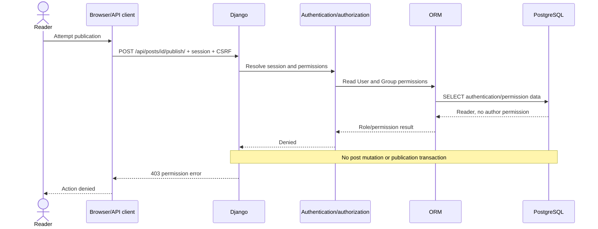

# API workflows

These diagrams are editable source for manual Lucidchart recreation. No Lucidchart export exists yet.

## Success: draft to publication

```mermaid
sequenceDiagram
    actor User as Author
    participant Client as Browser/API client
    participant Django
    participant Auth as Authentication/authorization
    participant ORM
    participant DB as PostgreSQL
    User->>Client: Create draft
    Client->>Django: POST /api/posts/ + session + CSRF
    Django->>Auth: Validate session, CSRF, Author/add_post
    Auth-->>Django: Authorized
    Django->>Django: Validate serializer; assign current user
    Django->>ORM: Save draft; generate stable slug
    ORM->>DB: INSERT Post
    DB-->>ORM: Row ID
    ORM-->>Django: Draft
    Django-->>Client: 201 draft JSON
    User->>Client: Publish
    Client->>Django: POST /api/posts/id/publish/
    Django->>Auth: Check role, change permission, ownership
    Auth-->>Django: Authorized
    Django->>ORM: Lock row; validate; set status/timestamp
    ORM->>DB: SELECT FOR UPDATE, UPDATE, COMMIT
    DB-->>ORM: Published row
    ORM-->>Django: Post
    Django-->>Client: 200 published JSON
    Client-->>User: Publication confirmed
```

## Failure: Reader attempts to publish


