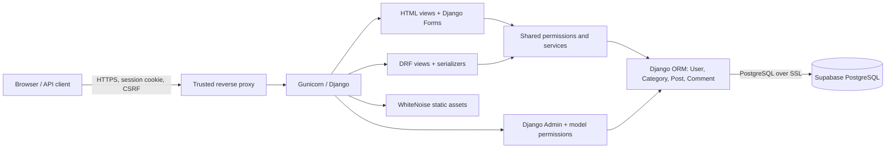

# Architecture

BlogSphere is a server-rendered monolith. Django Templates and DRF viewsets share the same models, permission helpers, and publication/comment services. The browser sends session cookies and a CSRF token on unsafe requests. Django authenticates the session, authorizes the action and resource, validates input, writes via ORM, and returns HTML or JSON. Public queries always filter status before detail lookup.

The deployment boundary is one Linux application process group and one remote database. Node is build-time only. WhiteNoise serves compiled CSS, JavaScript, and local SVG images. No Supabase SDK/Auth/Storage is used. Sessions live in the database. Login uses Django's safe redirect validation. Logout is CSRF-protected POST.

Reader registration cannot choose roles. Author group membership plus model permission grants authoring. Ownership is checked on every write. Limited staff must possess the relevant permission; superusers retain Django's explicit override. HTML author dashboards show only the current user's posts; administrators manage all content via Admin or authorized API operations.

Publication/comment services use transactions and row locks to coordinate comment creation with unpublishing on PostgreSQL. SQLite does not implement those row locks. Ordinary edits are last-write-wins; no optimistic concurrency versioning is implemented. Both interfaces validate plain text and render it escaped.

Lists use `select_related` for author/category, pagination for posts/comments/categories, and matching indexes. Search is bounded query text using case-insensitive contains; it can scan content and should be measured before scaling. Supabase SSL, migrations, and a rolled-back ORM workflow smoke test passed; the full suite and concurrent lock stress tests remain outstanding.

This is editable Mermaid source. A Lucidchart document or exported PDF has not been produced; recreate and export the diagram there for the assignment.
