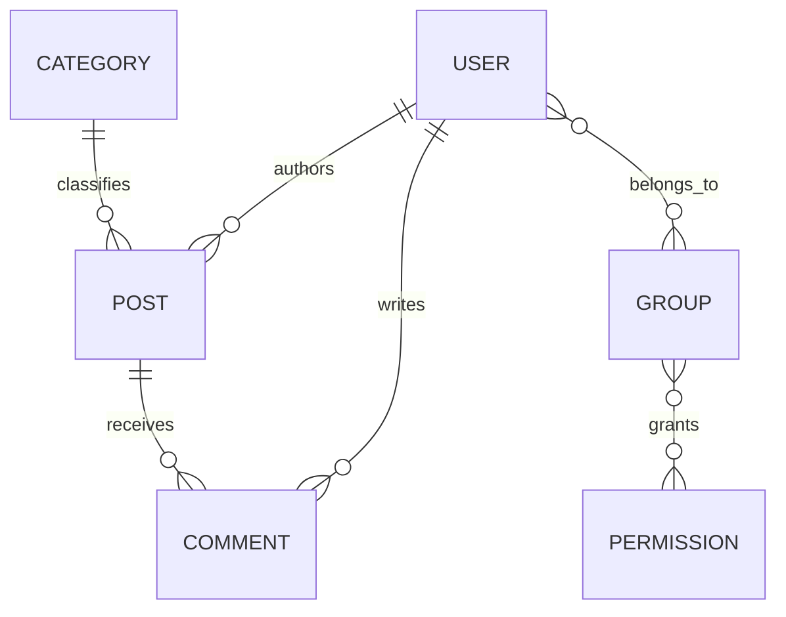

# Database design

Built-in Django User and Group remain authoritative. No custom authentication model.

| Model | Fields and constraints |
|---|---|
| Category | BigAutoField id; required unique name varchar(100); required unique URL slug varchar(120) |
| Post | id; required title varchar(200); unique stable slug varchar(220); nonblank content text; optional excerpt varchar(300); status DRAFT/PUBLISHED; required author/category FK; optional cover_image from five local choices; created_at/updated_at; nullable published_at |
| Comment | id; required post/user FK; nonblank content text, max 2,000 validated characters; created_at |

Foreign keys are database-enforced. Deleting a User cascades their posts/comments; deleting a Post cascades its comments. Deleting a Category is PROTECT while referenced, including by drafts. This prevents orphaned articles. Review account deletion carefully because authored content is removed.

Unique fields and FK indexes are automatic. Additional compound indexes: Post(status, descending published_at), Post(author, descending created_at), Comment(post, created_at). Check constraints restrict status and require a publication timestamp for published rows. Nonblank and cover-choice validation run through forms/serializers and Post.full_clean; raw SQL is outside this validation boundary.

Post slug combines a normalized title prefix with a UUID4 hex suffix. Non-Latin/empty normalized titles use `article`. A unique database constraint is the final authority; random collisions are negligibly likely, and failure does not overwrite another post. Slugs never change when titles change. Original publication time is preserved across unpublish/republish. Repeated publication updates the existing row.

Registration lowercases email and checks `email__iexact`; built-in User lacks a database uniqueness constraint on email. Concurrent registration/admin duplication remains possible and is explicitly tested only for sequential duplicate submissions.

`blog/migrations/0001_initial.py` creates the schema. Django auth/admin/session migrations provide supporting tables. `makemigrations --check` detects drift. SQLite migration execution is local evidence only; apply to a separate Supabase development database and run the suite there before claiming PostgreSQL integration success. Never run test DB creation against shared production infrastructure.
